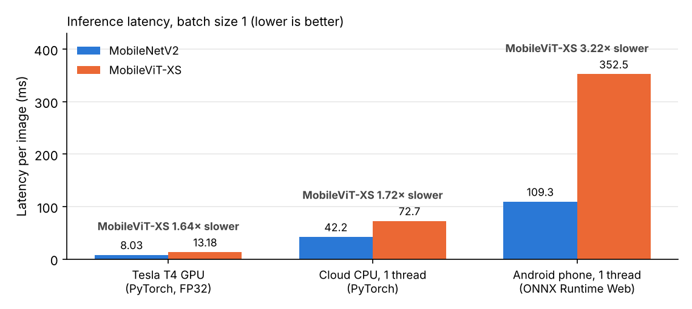
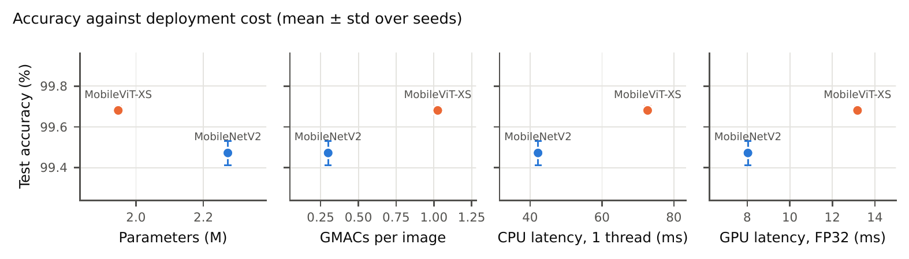
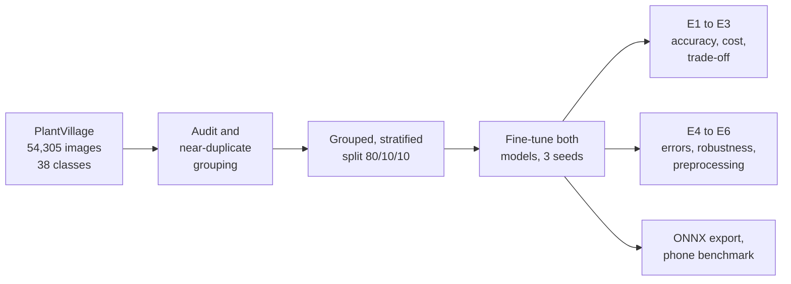
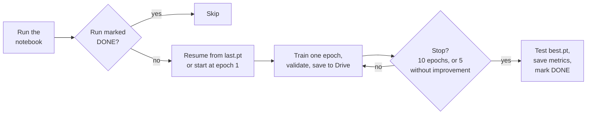

# Hybrid CNN-ViT for Edge Devices

**Accuracy vs. deployability trade-off in plant disease classification**

This project compares a lightweight CNN, **MobileNetV2**, with a lightweight hybrid CNN-ViT, **MobileViT-XS**, on the PlantVillage leaf disease dataset (38 classes). Both models are fine-tuned under the same conditions. We then measure accuracy and the cost of running them: parameters, model size, operations, and latency on a GPU, a CPU core and an Android phone.

The question: **is the hybrid model's extra accuracy worth its deployment cost on an edge device?**

**Authors:** Muhammad Umer, Muhammad Ahmed and Sundas Habib, National University of Computer and Emerging Sciences (FAST-NUCES), Lahore.

Paper: [paper/main.pdf](paper/main.pdf). Notebook with all outputs: [notebooks/experiments_final.ipynb](notebooks/experiments_final.ipynb).

## Results

Test set of 5,431 images. Results are the mean ± std over 3 training seeds.

| | MobileNetV2 | MobileViT-XS |
|---|---|---|
| Test accuracy | 99.47 ± 0.06 % | **99.68 ± 0.02 %** |
| Macro F1 | 99.17 ± 0.07 % | **99.46 ± 0.03 %** |
| Wrong predictions | 28.7 | **17.3** |
| Parameters | 2.27 M | **1.95 M** |
| Weights (FP32) | 9.3 MB | **7.9 MB** |
| Operations (GMACs) | **0.30** | 1.03 |
| Latency, Tesla T4 GPU | **8.0 ms** | 13.2 ms |
| Latency, CPU, 1 thread | **42.2 ms** | 72.7 ms |
| Latency, Android phone | **109 ms** | 352 ms |





Main findings:

- **The hybrid model is more accurate, but only slightly.** It made about 40% fewer errors. However, the gain is 0.21 percentage points, and McNemar's test found it significant in 2 of the 3 seeds. Most of the gain is on similar diseases of the same crop, such as corn Cercospora leaf spot and Northern Leaf Blight.
- **Fewer parameters do not mean a faster model.** MobileViT-XS has 14% fewer parameters but needs 3.4 times the operations.
- **The latency cost depends on the runtime.** MobileViT-XS was 1.6 to 1.7 times slower in PyTorch on cloud hardware, but 3.2 times slower on the phone. A desktop benchmark would understate the cost on the phone by about half.
- **Neither model is robust to poor images.** Under blur, noise, JPEG compression and low resolution, the accuracy of both models fell to between 14% and 50% at the strongest level. Their average robustness was about the same (74.2% vs 74.0%).

**Recommendation.** Choose MobileNetV2 when speed matters, for example for continuous camera scanning or on low-end phones (about 9 images per second on our phone). Choose MobileViT-XS for single-photo diagnosis, where a 0.35 s response is acceptable and fewer errors matter more.

## How the study was done



**Data.** The Kaggle copy of PlantVillage had near-duplicate images in both its train and val folders. We pooled all images, grouped duplicates, and made a new split where each group stays in one set (StratifiedGroupKFold, seed 42). The split is fixed in [splits/manifest.csv](splits/manifest.csv), and the checks are in [reports/split_report.md](reports/split_report.md).

**Training.** Both models start from ImageNet weights on Hugging Face (google/mobilenet_v2_1.0_224 and apple/mobilevit-x-small), and each uses its own input size and preprocessing. Both are trained the same way:

| Setting | Value |
|---|---|
| Optimizer | AdamW, lr 1e-4, weight decay 1e-4 |
| Schedule | cosine decay, updated every step |
| Batch size | 32 |
| Epochs | at most 10, early stopping with patience 5 on validation loss |
| Precision | FP16 mixed precision |
| Augmentation | horizontal flip, rotation, brightness and contrast jitter |
| Checkpoint used for testing | lowest validation loss |

**Training on free Colab.** Every run saves its state to Google Drive after each epoch. If the session disconnects, running the notebook again continues the run from the same point, and a finished run is never trained again.



**Edge test.** Both seed-42 models were exported to ONNX (opset 18) and timed on a Tecno Spark 20 Pro+ (Android 14). The phone ran ONNX Runtime Web 1.20.1 (WebAssembly SIMD, 1 thread, FP32), and each model did 100 timed runs after warm-up. The raw result is in [edge/results/](edge/results/).

## Repository layout

```
├── notebooks/
│   ├── experiments.ipynb         notebook to run on Colab
│   └── experiments_final.ipynb   same notebook with all outputs
├── src/
│   ├── dataset/                  audit, duplicate grouping, split, loaders
│   └── experiments/              training, evaluation, benchmark, robustness,
│                                 Grad-CAM, plots and LaTeX tables
├── splits/manifest.csv           fixed train/val/test split
├── reports/                      dataset audit and split reports
├── edge/                         ONNX export, phone benchmark page, phone results
├── paper/                        IEEE paper (LaTeX source, figures, tables, PDF)
├── tests/                        check that GPU and CPU preprocessing match
└── docs/                         proposal, dataset description, README images
```

## Reproducing the results

**1. Get the data.** Download PlantVillage from [Kaggle](https://www.kaggle.com/datasets/mohitsingh1804/plantvillage). Upload the zip to MyDrive/cnn-vit-research/data/ on Google Drive.

**2. Train and evaluate.** Open notebooks/experiments.ipynb in Colab with a GPU runtime, then run all cells. The notebook mounts Drive, clones this repository and unzips the data to the local disk. It then trains the 8 runs: 2 models × 3 seeds, plus 2 ablation runs. Finally, it runs E1 to E6 and writes the tables and figures. On a T4, one run takes about 30 minutes for MobileNetV2 and 45 minutes for MobileViT-XS. If the session stops, run the notebook again to continue.

**3. Export to ONNX.** This step needs no GPU.

```bash
pip install -r requirements.txt onnx onnxscript onnxruntime
```

```bash
python -m edge.export_onnx <drive>/cnn-vit-research/runs edge/models
```

**4. Time the models on a phone.** The page loads the models as base64 text:

```bash
for m in mobilenetv2 mobilevit_xs; do base64 -w0 edge/models/$m.onnx > edge/models/$m.onnx.b64.txt; done
```

Host the edge/ folder on any static web server and open phone_benchmark.html on the phone. The page checks that each model gives the same output as PyTorch on a test input, then times it.

**5. Build the paper.** Compile paper/main.tex with pdfLaTeX and Biber, for example on Overleaf.

## Requirements

Python 3.10+, PyTorch, torchvision, Hugging Face Transformers 4.40+, scikit-learn, SciPy, pandas, matplotlib. See [requirements.txt](requirements.txt).
